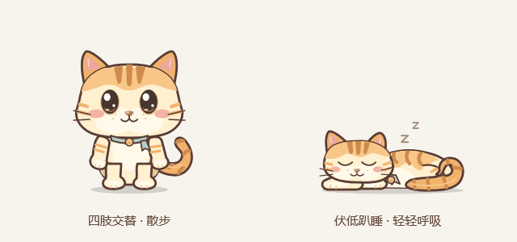
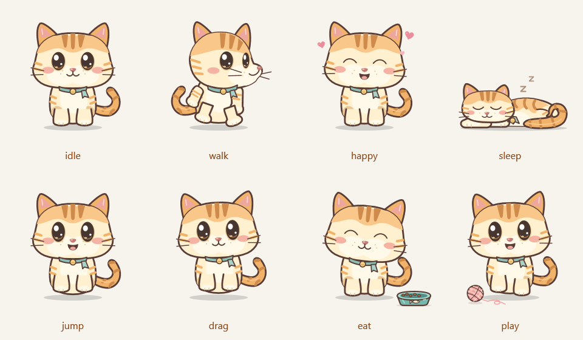

# 糯米 · 小猫桌宠

一只陪在 Windows 桌面上的奶油橘小猫。它会眨眼、摇尾巴、散步，也会在摸摸时冒出爱心，吃点猫粮、玩玩毛线球，累了就趴下来睡一会儿。





[查看左右行走时的头部朝向对照](docs/walk-directions.png)

## 它会做什么

- **走路**：两只手臂交替摆动，双脚交替迈步，身体随步伐轻轻起伏；头部朝行进方向转为侧脸，向左走看左、向右走看右。
- **趴着睡觉**：身体放低、前爪伸在脸旁、尾巴蜷起，伴随轻微呼吸和浮动的 `Z`。
- **互动**：单击摸摸、双击跳跃、拖动换位置，还会说几句悄悄话。
- **喂食与玩耍**：猫身和托盘右键菜单都能喂猫粮、玩毛线球，互动时会叫醒小猫。
- **桌面陪伴**：透明背景、可选置顶、三档大小、可暂停自由走动。
- **记住位置**：保存大小、走动、置顶和当前位置，下次启动恢复；保存位置失效时返回主屏幕。
- **方便找回**：托盘菜单、托盘图标双击和重复启动都可以把小猫带回主屏幕右下角。
- **本地运行**：偏好和运行状态保存在程序目录；不需要登录账号。

## 运行环境

| 项目 | 要求 |
| --- | --- |
| 操作系统 | Windows 10 / Windows 11 |
| 桌面 | 当前用户的 Windows 交互式桌面 |
| 框架 | .NET Framework 4.8 环境，使用 WPF 和 Windows Forms 托盘组件 |
| 构建工具 | Windows PowerShell 与系统 .NET Framework C# 编译器 `csc.exe` |
| 其他运行依赖 | 无需 Python、Node.js、浏览器或单独的 .NET SDK |

构建脚本使用 `%WINDIR%\Microsoft.NET\Framework64\v4.0.30319` 下的编译器和框架程序集，适用于具备对应组件的 64 位 Windows 环境。

## 快速开始

### 从源码构建

1. 完整项目位于 **`master` 分支**。使用下面的命令克隆，或在 GitHub 切换到 `master` 后点击 **Code → Download ZIP** 并解压。

```powershell
git clone --branch master --single-branch https://github.com/MAyang38/nuomi-desktop-pet.git
cd nuomi-desktop-pet
```
2. 打开仓库目录，在资源管理器地址栏输入 `powershell` 并回车。
3. 执行：

```powershell
powershell.exe -NoProfile -ExecutionPolicy Bypass -File .\build.ps1
```

看到 `KittenPet.exe built successfully.` 后，目录中会生成 `KittenPet.exe`。

4. 在资源管理器中双击 `KittenPet.exe`，或执行：

```powershell
.\KittenPet.exe
```

小猫首次启动默认出现在主屏幕工作区的右下角，随后会偶尔散步；已有有效保存位置时会恢复位置。把程序放在有写入权限的普通文件夹中，方便保存偏好和诊断文件。

### 已有编译好的程序

直接双击 `KittenPet.exe` 即可。程序为便携应用，不需要安装，也不会自动添加开机启动。

> 启动时要在你实际使用的 Windows 桌面执行。远程执行器、自动化工具或隔离桌面中的进程，即使已经运行，也可能不会显示在你正在看的桌面上。

## 怎么陪小猫玩

| 操作 | 效果 |
| --- | --- |
| 单击小猫 | 摸摸；显示爱心和一句话，睡着时会醒来 |
| 双击小猫 | 跳一下，睡着时会醒来 |
| 按住鼠标左键拖动 | 移动小猫，松开后留在新的位置 |
| 右键 → 摸摸糯米 | 与单击相同 |
| 右键 → 跳一下 | 与双击相同 |
| 右键 → 喂点猫粮 | 吃猫粮约 5 秒，显示小鱼碗；睡着时会醒来 |
| 右键 → 玩毛线球 | 玩毛线球约 6 秒，小球轻弹滚动；睡着时会醒来 |
| 右键 → 自由走动 | 开启或暂停偶尔散步 |
| 右键 → 睡一会儿 | 趴下睡觉，保持睡眠直到叫醒或互动 |
| 右键 → 叫醒小猫 | 结束睡眠 |
| 右键 → 小猫大小 | 选择小、中、大三档 |
| 右键 → 置顶显示 | 开启或关闭置顶 |
| 右键 → 回到右下角 | 将小猫送回主屏幕右下角 |
| 右键 → 退出小猫 | 关闭程序并移除托盘图标 |

**系统托盘**：点击任务栏右侧的“显示隐藏的图标”可找到小猫图标。双击图标可找回小猫；右键可以找回、睡觉 / 叫醒、喂点猫粮、玩毛线球或退出。

**重复启动**：同一 Windows 会话中只运行一只糯米。再次打开程序会找回已经运行的小猫。

**命令行退出**：

```powershell
.\KittenPet.exe --stop
```

这个命令需在小猫所在的 Windows 会话和桌面中运行。

## 动画状态

| 状态 | 表现 | 进入方式 |
| --- | --- | --- |
| `idle` | 站立、眨眼、轻微呼吸和摆尾 | 没有其他活动时 |
| `walk` | 摆臂、迈步、身体起伏，侧脸随行进方向左右转向 | 开启自由走动后间歇发生 |
| `happy` | 高兴的表情、爱心 | 摸摸小猫 |
| `sleep` | 身体趴低、前爪伸出、蜷尾、闭眼呼吸 | 右键选择睡觉 |
| `jump` | 短暂跳起 | 双击或菜单操作 |
| `drag` | 被拎起时的表情与姿态 | 按住左键拖动 |
| `eat` | 吃猫粮，小鱼碗里的猫粮逐渐减少 | 猫身或托盘菜单“喂点猫粮”，持续约 5 秒 |
| `play` | 玩毛线球，小球轻弹、滚动 | 猫身或托盘菜单“玩毛线球”，持续约 6 秒 |

散步会在屏幕工作区边缘转向。拖动后会按所在屏幕的工作区限制位置；“找回”始终返回主屏幕。显示器布局、缩放或工作区变化时，程序也会尝试把小猫带回可见区域。

## 偏好与诊断文件

这些文件在运行时生成，不需要随源码提交。

### `settings.txt`

在程序目录保存五行设置，依次是缩放比例、是否自由走动、是否置顶、窗口左坐标 `Left`、窗口上坐标 `Top`。旧版三行文件仍可读取；缺少坐标时使用主屏幕右下角。例如：

```text
0.9
true
true
800
600
```

| 行 | 含义 | 菜单对应值 |
| --- | --- | --- |
| 1 | 大小比例，小数点使用 `.` | 小 `0.68`、中 `0.9`、大 `1.15` |
| 2 | 是否自由走动 | `true` / `false` |
| 3 | 是否置顶 | `true` / `false` |
| 4 | 窗口左坐标 `Left`，WPF 逻辑坐标 | 拖动后保存；多屏桌面可以是负数 |
| 5 | 窗口上坐标 `Top`，WPF 逻辑坐标 | 拖动后保存；多屏桌面可以是负数 |

建议通过右键菜单更改。拖动结束、更改偏好和正常退出时会保存当前位置。再次启动会恢复有效坐标；原屏幕断开等情况导致位置失效时，返回主屏幕右下角。保存的是 WPF 逻辑坐标，Windows 缩放变化可能影响实际显示位置。睡眠状态仍不会跨启动保存。

若需恢复默认设置，先退出小猫，再删除 `settings.txt` 后启动。

### `status.json`

程序运行时约每三秒写入一次，退出时写入 `closed`。可用于确认进程是否运行、当前动作和位置：

```json
{
  "status": "running",
  "pid": 1234,
  "mood": "idle",
  "seconds": 12.3,
  "x": 800.0,
  "y": 600.0,
  "roaming": true,
  "size": 0.9,
  "topmost": true,
  "updatedAt": "2026-10-21T08:00:00.0000000Z"
}
```

坐标为 WPF 逻辑坐标，`size` 是大小比例，`topmost` 是置顶状态，`updatedAt` 为 UTC 时间；示例数值仅用于解释格式。文件可能保留上次运行的状态，判断时请同时查看更新时间和进程状态。

### `error.log`

启动或未处理异常会尝试写入此文件。反馈问题时可以提供相关错误片段；分享前请检查是否包含自己的本地路径等信息。

## 源码结构

```text
nuomi-desktop-pet/
├─ KittenPet.cs       # 应用入口、透明窗口、交互、状态切换、托盘与偏好
├─ CatArt.cs          # 站立、行走、互动等状态的 WPF 矢量绘制
├─ CatSleepArt.cs     # 独立的趴睡姿态与呼吸动画
├─ CatInteractionArt.cs # 猫粮碗、猫粮和毛线球的独立矢量绘制
├─ PetSettings.cs     # 兼容旧版的偏好读取与五行设置保存
├─ build.ps1          # 使用系统 C# 编译器生成 KittenPet.exe
├─ 使用说明.txt        # 随程序阅读的简明说明
├─ docs/
│  ├─ preview.gif     # 行走与趴睡的动画预览
│  ├─ interaction-preview.png # 包含喂食和玩球的八种状态预览
│  └─ walk-directions.png # 待机、向左走、向右走的实际画布对照
├─ tests/
│  ├─ Test-Settings.ps1 # 设置读取、保存及旧版兼容回归检查
│  ├─ Test-Behavior.ps1 # 桌宠动作与窗口行为回归检查
│  ├─ BehaviorTestRunner.cs # 隔离运行的 WPF 集成测试
│  ├─ Test-WalkDirection.ps1 # 实际画布左右行走朝向渲染检查
│  └─ WalkDirectionTestRunner.cs # 头部朝向像素检查与对照图
├─ .gitignore
├─ .gitattributes
└─ README.md
```

小猫通过 WPF `DrawingContext` 绘制，无需外部图片素材。窗口使用透明背景和约 30 FPS 的刷新定时器；动作随时间计算。托盘使用 Windows Forms `NotifyIcon`，单实例和找回通过命名互斥锁与窗口消息实现。

修改绘制或交互代码后，先退出正在运行的小猫，再执行 `build.ps1`，然后重新启动。运行中的可执行文件可能被 Windows 占用，导致构建无法覆盖。

### 回归检查

在仓库目录运行以下命令。三个脚本均支持可选参数 `-WorkDirectory`，用于指定测试工作目录：

```powershell
powershell.exe -NoProfile -ExecutionPolicy Bypass -File .\tests\Test-Settings.ps1
powershell.exe -NoProfile -ExecutionPolicy Bypass -File .\tests\Test-Behavior.ps1
powershell.exe -NoProfile -ExecutionPolicy Bypass -File .\tests\Test-WalkDirection.ps1
```

例如使用仓库下的 `test-work` 文件夹：

```powershell
powershell.exe -NoProfile -ExecutionPolicy Bypass -File .\tests\Test-Settings.ps1 -WorkDirectory .\test-work
powershell.exe -NoProfile -ExecutionPolicy Bypass -File .\tests\Test-Behavior.ps1 -WorkDirectory .\test-work
```

行为检查依赖 Windows WPF 环境；实际多屏和不同 DPI 下的显示效果仍需在对应桌面环境验证。

## 常见问题

### 程序运行了，但桌面没有小猫

1. 再次双击 `KittenPet.exe`，尝试找回到右下角。
2. 展开系统托盘，双击小猫图标，或右键选择“找回小猫”。
3. 确认程序启动于当前登录用户正在使用的交互式桌面。如果是自动化工具启动，请退出该进程，然后在资源管理器中手动双击程序。
4. 若已有界面但被其他窗口遮住，开启右键菜单中的“置顶显示”。
5. 若启动失败，查看同目录 `error.log`；`status.json` 只能作为辅助诊断，不能单独证明窗口在当前桌面可见。

### 为什么小猫暂时不走？

自由走动是间歇触发的，平时也会站着休息。确认右键菜单“自由走动”已勾选，并等待片刻；睡眠、互动、跳跃、拖动和打开右键菜单时会暂停走动。

### 为什么睡着后不会自己起来？

“睡一会儿”会持续保持趴睡状态。选择“叫醒小猫”、摸摸、双击跳跃、喂猫粮或玩毛线球即可唤醒。

### 构建提示找不到 `csc.exe` 或框架程序集

检查系统是否具备 .NET Framework 4.8 的对应组件，以及脚本指定的 `Framework64` 目录是否存在。这个脚本依赖 Windows 的 .NET Framework 编译环境；只有新版 .NET SDK 并不等同于存在这些框架路径。

### 构建提示无法写入 `KittenPet.exe`

先通过小猫或托盘右键菜单退出，再重新编译。也可以在同一会话中执行 `KittenPet.exe --stop`。请确认程序目录有写入权限。

### 大小、走动、置顶或位置没有保存

确认程序所在目录可以写入。把文件夹移到自己的普通文档目录后重试，避免放在需要额外权限才能写入的位置。

### 全屏游戏或特殊窗口上看不到小猫

这是普通 WPF 置顶窗口。独占全屏、其他特殊置顶窗口以及不同会话 / 桌面的内容可能影响显示；可以先切回普通 Windows 桌面再找回。

## 当前范围

- 仅支持 Windows 桌面；没有 macOS、Linux 或移动端版本。
- 不自动配置开机启动。
- 不支持攀爬窗口、识别应用内容、语音对话或联网聊天。
- 多屏和不同 DPI 下的位置会受 Windows 的工作区与缩放影响，可以随时通过托盘找回。

欢迎通过 Issue 提供复现步骤、Windows 版本、显示器缩放，以及相关错误信息；涉及动画时，附上一小段录屏会更容易定位。
